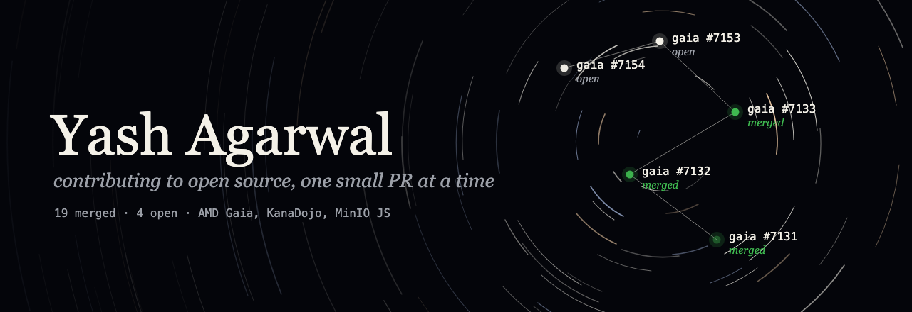
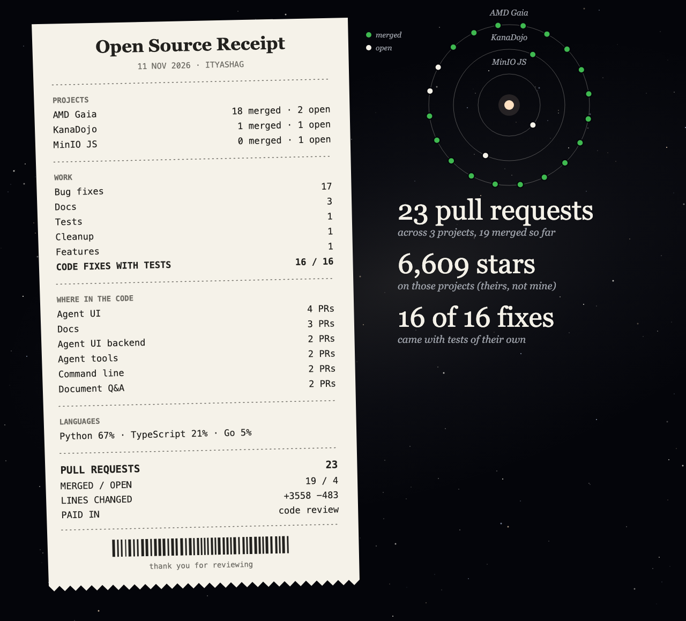

# orbit-profile

A GitHub profile README that draws your open-source pull requests as a night sky,
rebuilt every day from the GitHub API.

- **The cover** turns its star trails slowly and draws your five latest PRs in as a constellation. Merged ones pulse green.
- **The receipt** sums up the work: projects, kinds of change (from conventional-commit titles), where in the code it went, languages, and how many fixes came with tests.
- **The orrery** gives each project an orbit and each PR a moon. The busiest project gets the widest orbit.
- **The README** lists what each PR does, taken from the first sentence of its Summary, so a visitor reads the impact, not just a title.

Everything is plain SVG with CSS animation, which GitHub renders inline. Motion stops for visitors who ask for reduced motion.

## Set it up in 3 steps

1. Click **Use this template** and name the new repository exactly your username (for example `octocat/octocat`). That's the repo GitHub shows on your profile.
2. Open **Actions**, pick **Refresh profile**, and click **Run workflow**. It builds `README.md` and the two images and commits them.
3. Optionally, edit `profile.json` (below). The workflow runs again every day at 03:17 UTC.

To build locally instead: `GH_TOKEN=<token> python3 build.py <username>`. It needs Python 3.9+ and no packages. Without `GH_TOKEN` it uses the GitHub CLI's login.

## `profile.json`

Every field is optional.

| Field | What it does |
|---|---|
| `name` | Name on the cover. Defaults to your GitHub display name. |
| `tagline` | The italic line under your name. |
| `intro` | A line of Markdown under the cover. |
| `min_stars` | A project needs this many stars to count as open source on the receipt (default 1000). PRs to smaller repos go in a collapsed "Smaller projects" table. |
| `max_prs` | How many of your latest PRs to read (default 300). |
| `show_smaller_projects` | `false` hides the smaller-projects table. |
| `project_names` | Display names, e.g. `{"amd/gaia": "AMD Gaia"}`. Defaults to the repo name. |
| `areas` | Names for parts of a codebase by path prefix, first match wins: `{"amd/gaia": [["src/gaia/rag/", "Document Q&A"], ["docs/", "Docs"]]}`. Defaults to the top folder. |
| `plain` | Your own one-line description for a PR whose Summary starts with code: `{"<pr url>": "What it does for people."}` |
| `built` | Your own repos to feature: `[{"repo": "my-tool", "title": "My Tool", "line": "what it does"}]` |

Anything in an `extra.md` file is added near the end of the README.

## What it reads

Only public data: your public repositories and your pull requests to public repositories, through GitHub's GraphQL API. The workflow uses its own short-lived `GITHUB_TOKEN` and needs no secrets. Every number on the page comes from the API at build time.

## License

MIT
